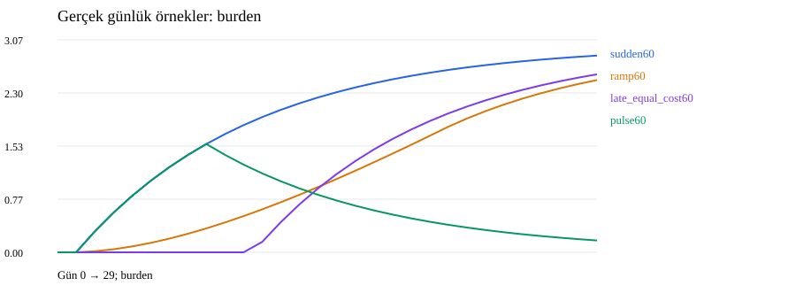
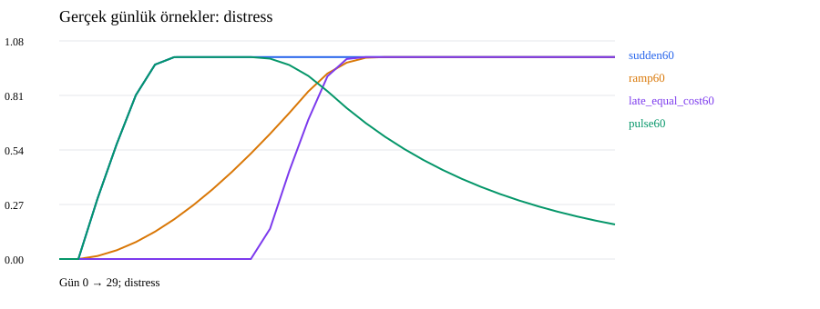

# v3.1 karakter araştırması — ayrıntılı rapor

## Yönetici özeti
**508 ana + 104 keşif amaçlı ek = 612 koşu; 55 ana senaryo. Davranış kodu ve katsayıları değiştirilmedi.** Karakter tarifi ölçüt olarak korundu, sonuçlar o tarife uysun diye model düzeltilmedi.
Bu çalışma kod içi doğrulama ve kontrollü simülasyon araştırmasıdır. Gerçek insan psikolojisinin, ideolojilerin veya toplumların bilimsel doğrulaması değildir.
Ana kol: 55 senaryo × 8 tohum × 100 kişi × 30 gün = 440 koşu. Ek olarak 48 tarihsel v2/v3.0 karşılaştırması, 8 adet 1000 kişilik ölçek kontrolü ve 12 adet 180 günlük uzun ufuk koşusu yapıldı.
Başlıca sonuç: kaynak kapıları, ayrı destek çekme ve katılım ayrımı çalışıyor; fakat iletişim karakterleri ve ideolojinin içeriği eksik. Kitle mekanizması gerçek mekândan çok buluşma kaydını sayıyor. Düşük geçiş oranını tek başına başarı saymak yanlış.

## 1. Araştırma sınırı ve kaynaklar
[Kullanıcının altı karakter sözleşmesi](../docs/six-character-contract.md), motor, dynamics, appraisal, collective ve üç dondurulmuş profil okundu. Altı oran ve kişiler arasındaki heterojen örneklenmiş özellikler korundu. [Dondurulmuş protokol](character-study/protocol.json) kaynak SHA256 değerlerini, bütün koşuları ve müdahale sınırlarını içerir.
Yeni mekanizma, API, panel veya genel amaçlı araştırma platformu kurulmadı; sabit deney betiği ve kayıt analizörü eklendi. %20–30 veya başka bir sonuca göre katsayı ayarlanmadı.

## 2. Deney düzeni ve karıştırılmaması gerekenler
- Ana senaryolar: ekonomik doz/zamanlama; atıf × fayda; kaynak rolü/çelişkili açıklamalar; gerçek/olmayan katılım; yönetici–zengin bağımlılığı.
- Kaynak mikro-deneylerinde bütün kollara aynı kontrollü bağlantılar ve kamuya açık başlangıç kaynak bilgisi verildi (güven .8, gecikme 10 dakika); kişilik ve ekonomik değerler değiştirilmedi. Her grupta tek bir hedef var. Bu ağ, doğal ağla sonuç oranı karşılaştırması değildir.
- Kaynak mikro-deneylerinde Wait politikası, okumayı ve günlük dinamikleri bırakıp otomatik eylemi durdurur. Zorunlu yalnız/iki kişi/ayrılma kalabalık kontrolleri de Wait kullanır. Diğer ana kollar özerk referans politikayı kullanır. Zorlanan katılım karakterin bunu kendisinin seçeceğini kanıtlamaz.
- Aynı tohumlarda ortak fiziksel/kişilik başlangıç hashleri eşit. Yeni/eski zihinsel durum şemalarının aynı olduğu iddia edilmedi. Mesajın olumlu olması doğrulanmış ekonomik fayda gerçekleştiği anlamına gelmez.
- Ani %60 ve kademeli toplam %60 aynı son fiyata gider ama toplam ödenen maliyetleri eşit değildir. late_equal_cost60 kolu, kademeli kolun 30 günlük maliyetini de eşler. Bu müdahale eşlemesidir, davranış katsayısı ayarı değildir.
- Yüzdeler tohum başına kişi oranlarının ortalamasıdır. Aralıklar tohum min–maks; paired-comparisons dosyasındaki bootstrap yalnız tohum belirsizliğidir, toplumsal olasılık değildir. 1000 kişilik iki tohum keşifseldir.

## 3. Bütün ana senaryoların sonuçları
Geçiş = dönem içinde en az bir kez siyasi kutup değiştirme. Destek çekme ayrı; katılım ayrı; temel yönelim ayrı. Gösterilenler nüfus yüzdesidir.
| Senaryo | Geçiş ort. % [min–maks] | Destek çekme % | Katılım % | Ortak ifade % | Reddedilen müdahale |
|---|---|---|---|---|---|
| benefit-aligned | 0.00 [0–0] | 0.00 | 0.00 | 0.00 | 0 |
| benefit-peer | 0.00 [0–0] | 0.00 | 0.00 | 0.00 | 0 |
| contract-and-crowd | 0.00 [0–0] | 0.25 | 4.00 | 3.88 | 0 |
| contract-repeat | 0.00 [0–0] | 0.25 | 0.00 | 0.00 | 0 |
| contract-valid | 0.00 [0–0] | 0.25 | 0.00 | 0.00 | 0 |
| contract-wrong | 0.00 [0–0] | 0.00 | 0.00 | 0.00 | 8 |
| contradictory | 0.00 [0–0] | 0.00 | 0.00 | 0.00 | 0 |
| crowd-late-invite | 0.00 [0–0] | 0.00 | 2.38 | 2.25 | 0 |
| crowd-messages-only | 0.00 [0–0] | 0.00 | 0.00 | 0.00 | 0 |
| crowd-no-shock | 0.00 [0–0] | 0.00 | 4.00 | 4.00 | 0 |
| crowd-none | 0.00 [0–0] | 0.00 | 5.25 | 5.25 | 0 |
| crowd-peer | 0.00 [0–0] | 0.00 | 0.00 | 0.00 | 0 |
| crowd-same-place-split | 0.00 [0–0] | 0.00 | 2.00 | 0.00 | 0 |
| crowd-solo | 0.00 [0–0] | 0.00 | 1.00 | 0.00 | 0 |
| crowd-support-loss | 0.00 [0–0] | 0.00 | 2.00 | 2.00 | 0 |
| crowd-two | 0.00 [0–0] | 0.00 | 2.00 | 2.00 | 0 |
| deflation20 | 0.00 [0–0] | 0.00 | 0.00 | 0.00 | 0 |
| extreme900 | 0.00 [0–0] | 0.00 | 0.00 | 0.00 | 0 |
| forecast-accurate | 0.00 [0–0] | 0.00 | 0.00 | 0.00 | 0 |
| forecast-false | 0.00 [0–0] | 0.00 | 0.00 | 0.00 | 0 |
| i40-A-known | 0.00 [0–0] | 9.75 | 0.00 | 0.00 | 0 |
| i40-A-positive | 1.00 [0–4] | 9.75 | 0.00 | 0.00 | 0 |
| i40-external-known | 0.00 [0–0] | 0.00 | 0.00 | 0.00 | 0 |
| i40-external-positive | 0.00 [0–0] | 0.00 | 0.00 | 0.00 | 0 |
| i40-leader-known | 0.00 [0–0] | 9.75 | 0.00 | 0.00 | 0 |
| i40-leader-positive | 1.00 [0–4] | 9.75 | 0.00 | 0.00 | 0 |
| i40-unknown-known | 0.00 [0–0] | 0.00 | 0.00 | 0.00 | 0 |
| i40-unknown-positive | 0.00 [0–0] | 0.00 | 0.00 | 0.00 | 0 |
| i80-A-known | 0.00 [0–0] | 9.75 | 0.00 | 0.00 | 0 |
| i80-A-positive | 5.88 [1–12] | 9.75 | 0.00 | 0.00 | 0 |
| i80-external-known | 0.00 [0–0] | 0.00 | 0.00 | 0.00 | 0 |
| i80-external-positive | 0.00 [0–0] | 0.00 | 0.00 | 0.00 | 0 |
| i80-leader-known | 0.00 [0–0] | 9.75 | 0.00 | 0.00 | 0 |
| i80-leader-positive | 5.75 [0–12] | 9.75 | 0.00 | 0.00 | 0 |
| i80-unknown-known | 0.00 [0–0] | 0.00 | 0.00 | 0.00 | 0 |
| i80-unknown-positive | 0.00 [0–0] | 0.00 | 0.00 | 0.00 | 0 |
| late_equal_cost60 | 0.00 [0–0] | 0.00 | 0.00 | 0.00 | 0 |
| mild10 | 0.00 [0–0] | 0.00 | 0.00 | 0.00 | 0 |
| moderate40 | 0.00 [0–0] | 0.00 | 0.00 | 0.00 | 0 |
| none | 0.00 [0–0] | 0.00 | 0.00 | 0.00 | 0 |
| peer-authority-text | 0.00 [0–0] | 0.00 | 0.00 | 0.00 | 0 |
| power-reversal | 0.00 [0–0] | 0.00 | 0.00 | 0.00 | 0 |
| pressure-valid | 0.00 [0–0] | 0.00 | 0.00 | 0.00 | 0 |
| pulse60 | 0.00 [0–0] | 0.00 | 0.00 | 0.00 | 0 |
| ramp60 | 0.00 [0–0] | 0.00 | 0.00 | 0.00 | 0 |
| repeat-many | 0.00 [0–0] | 0.00 | 0.00 | 0.00 | 0 |
| repeat-once | 0.00 [0–0] | 0.00 | 0.00 | 0.00 | 0 |
| repeated_pulses60 | 0.00 [0–0] | 0.00 | 0.00 | 0.00 | 0 |
| severe80 | 0.00 [0–0] | 0.00 | 0.00 | 0.00 | 0 |
| source-aligned | 0.00 [0–0] | 0.00 | 0.00 | 0.00 | 0 |
| source-opposed | 0.00 [0–0] | 0.00 | 0.00 | 0.00 | 0 |
| source-ordinary | 0.00 [0–0] | 0.00 | 0.00 | 0.00 | 0 |
| source-same_group | 0.00 [0–0] | 0.00 | 0.00 | 0.00 | 0 |
| source-wealthy | 0.00 [0–0] | 0.00 | 0.00 | 0.00 | 0 |
| sudden60 | 0.00 [0–0] | 0.00 | 0.00 | 0.00 | 0 |

Reddedilen müdahaleler gizlenmedi: yanlış yöneticiye sözleşme iptali gibi bilinçli geçersiz girişler ile bütçeden reddedilen gerçek çağrılar [doğrulama dosyasında](character-study/validation.json) eylem türüne göre ayrıdır. Planlanmış gönderimi gerçekleşmiş iletişim saymadık.

## 4. Ani / kademeli şok: neyi gösteriyor?
Ani %60 kolunda ortalama siyasi geçiş %0.00; kademeli kolda %0.00. İkisinde de atıf veya alternatif tanıklığı otomatik verilmedi. Sıfır siyasi geçiş, kişilerin rahatsız olmadığı anlamına gelmez.
Gerçek günlük zarar/yük/rahatsızlık kayıtları:


Zarar başlangıç giderine göre ölçülüyor; referans gider/beklenti öğrenilerek yenilenmiyor. Rahatsızlık, birikmiş yükün 1’de kırpılmış hali. Bu nedenle farklı ekonomik yollar aynı doygun rahatsızlık değerine ulaşabilir. **Bu, alışma psikolojisinin uygulandığı anlamına gelmez.**
Maliyet-eşlenmiş kol da birikim/unutma ve olay zamanlaması farklarını içerir. Bu farkları otomatik “alışma etkisi” diye adlandırmak yanlış olur.

## 5. Kaynak ve karakter kapıları
Aşağıdaki hücreler her grubun tek hedefindeki normal konu görüşünün 50’den değişimi: 8 tohum ortalaması, 0–100 görüş puanı. Bunlar bütün grubun ortalama fikir değişimi değildir.
| Kaynak | Güç yanlısı | Muhalif | Burjuva/mevkili | Zengin | Huzursuz | Gözlemci |
|---|---|---|---|---|---|---|
| source-aligned | 21.044 | 20.774 | 20.124 | 20.584 | 21.107 | 19.755 |
| source-opposed | 0.000 | 0.000 | 20.124 | 20.584 | 21.107 | 19.755 |
| source-ordinary | 0.000 | 0.000 | 5.776 | 7.229 | 6.176 | 6.010 |
| source-same_group | 0.000 | 0.000 | 20.124 | 7.229 | 6.176 | 6.010 |
| source-wealthy | 0.000 | 0.000 | 5.776 | 7.229 | 6.176 | 6.010 |
| peer-authority-text | 0.000 | 0.000 | 5.776 | 7.229 | 6.176 | 6.010 |

İlk iki kesimde akran/diğer halk grubunun doğrudan fikir etkisinin sıfır olması ve mevkili kaynağın farklı etkisi birlikte ölçüldü. Mevkili orijinal kaynağın aracıyla yayılması temel motor testleriyle korunuyor. Metne “mevkiliyim” yazmak rol değiştirmiyor; kimlik motor tarafından doğrulanıyor. Gerçek dünyadaki sahte kimlik problemi burada modellenmiyor.
Gözlemcinin mevkili konu etkisi, yüksek temel yönelim direncine rağmen mevcut. Bu “bağımsız analiz yapan gözlemci” sözleşmesinin tamamının uygulanmadığına somut karşı örnek. Gözlemcilerin hiç kalabalığa katılmaması ise referans politikada açık dışlama; ölçülmüş psikolojik direnç değil.

## 6. Atıf ile alternatif faydası
Ağır şok + A atfı + olumlu B tanıklığı: ortalama %5.88 siyasi geçiş. Aynı tanıklık, belirsiz atıfla %0.00; A atfı fakat yalnız bilinirlikle %0.00.
Mevcut-kutup atfı başlangıçta A’yı destekleyen iki ağ çapasına yönelik A atfıdır; bütün nüfusun gizli bağlılığına göre kişiselleştirilmiş suçlama yok. Yayılım sonrasında her okuyucu kendi eriştiği bilgiyle değerlendiriliyor.
Yöneticiye atıf ile A’ya atıf semantik olarak aynı değildir: kişinin bilinen kamu kutbu değişirse yöneticiyi kutba bağlama da değişebilir. Bu farkı tek bir katsayının etkisi diye yorumlamıyoruz.

## 7. Altı grup ayrı ayrı
Ağır şok + A atfı + olumlu alternatif kolu; grup içi yüzdeler:
| Grup | Geçiş % | Destek çekme % | Temel yönelim değişim sayısı | Son özel sadakat |
|---|---|---|---|---|
| Güç yanlısı | 14.58 | 24.58 | 0 | 0.517 |
| Muhalif | 0.00 | 0.00 | 0 | 0.552 |
| Burjuva/mevkili | 6.67 | 10.00 | 0 | 0.548 |
| Zengin | 4.17 | 7.29 | 0 | 0.544 |
| Huzursuz | 0.00 | 0.00 | 0 | 0.620 |
| Gözlemci | 0.00 | 0.00 | 0 | 0.617 |

- **Güç yanlısı:** mevkili kapısı korunuyor; hız/sıklık ve değişen mevki/para gücünü takip eden strateji yok. Gizli güç tersine döndüğünde tepki vermemek doğru bilgi sınırıdır; mevkileri izleme özelliğinin doğrulandığı anlamına gelmez.
- **Muhalif:** kaynak simetrisi var; dinamik zıtlık ilişkisi yok. B başlangıcı, karşı grubun bütün davranışlarına muhalefet eden bir karar politikası değildir.
- **Burjuva:** yetki ve çıkış maliyetleri mevcut. Bir geçiş deterministik ve yerel gerekçeli olabilir ama bu, kapsamlı makam/kurum/ittifak çıkar hesabı yaptığı anlamına gelmez. Halkçı alt tip ve bastırılma yok.
- **Zengin:** yönetici bağımlılığı gerçek eylemle sınandı. Rekabet ve işveren–halk gelir akışı yok; employer alanı ekonomik etkiyi kendi başına oluşturmaz.
- **Huzursuz:** özerk katılım ve kısa süreli kolektif ifade var; her isyan/koalisyon veya yavaş-hızlı iletişim rejimi yok. Tarafsız başlangıç ile ilk partiye geçiş genel kuralları hâlâ ayrı inceleme gerektiriyor.
- **Gözlemci:** az çıkış bağlantısı var, gelen erişim aynı ölçüde kısıtlı değil. Temel yönelim v3.1’de bütün gruplarda donuk; gözlemciye özgü muhakeme kanıtı olarak kullanılamaz.

## 8. Kitle davranışında mantıklı ve sorunlu sonuçlar
Yalnız davet/katılım engeli kolunda ortak ifade %0.00; zorunlu tek katılımcıda %0.00; iki gerçek katılımcıda %2.00.
Aynı yer ve saatte iki ayrı buluşma kaydına bölünmüş iki gerçek katılımcıda ifade %0.00. Bu kayıt-id bağımlılığı, gerçek fiziksel birlikte bulunma modelinin sınırını gösteriyor: aynı meydan/aynı zaman tek başına kayıtları birleştirmiyor.
Şoksuz özerk çağrı kolunda katılım %4.00; şoklu çağrıda %5.25. Mevkili açıklaması ekonomik öfke olmadan da katılım doğurabilir. Bu otomatik mantıksızlık değildir; fakat katılımın hangi amaçla yapıldığı çok zayıf modelleniyor.
Ayrılan ve biten buluşmalarda ortak güç sıfırlanıyor; bütün kapalı buluşmalar temizlendi. Ancak güç endeksi psikolojik geri besleme veya kuruma etki hesabı değil, kişi sayısından türetilen bir çıktı. “Kitle psikolojisi bütünüyle uygulandı” denemez.

## 9. Ekonomik ve kurumsal kontroller
Yanlış yönetici iptali reddedildi; doğru yönetici gelir azaltabildi. Baskı, kamu desteği ile özel sadakatin farklı kalabildiğini gösterir. Bu, bütün halka baskı modeli değil; başlangıçta yöneticiye bağımlı zengin kapsamıdır.
Önemli ölçüm sınırı: losses, gelir iptalinin bir seferlik gelir farkını kaydeder; sonraki her gün vazgeçilen geliri losses’a tekrar eklemez. Bu yüzden sözleşme senaryosunda losses toplamını bütün ekonomik maliyet diye okumamak gerekir. Gerçek birikimli sonuç için eşleştirilmiş tasarruf farkına da bakılmalı. [Hedef gelir/tasarruf kayıtları](character-study/special-probes.json) saklandı.
Aşırı %900 fiyat artışı kolunda ortalama %100.00 kişi negatif tasarrufa indi. Negatif tasarruf iflas, işsizlik veya erişim kaybı üretmiyor. Bu kol sınır testi, gerçekçi kriz tahmini değildir.

## 10. Uzun ufuk ve ölçek
180 gün koşuları üç tohumla, son müdahale bittikten sonra eski tanıklığın etkisini de izler. Sıfır geçişi sonsuz imkânsızlığın deneysel kanıtı saymadık; tarafsızlık aday seçiminde A yanlılığı ve eşik kapıları koddan ayrıca görülebilir. Olumlu fayda tanıklığının son kullanma tarihi yok; güven güncellenmezse eski ifade uzun süre kararda kalabilir.
1000 kişilik dört senaryo yalnız iki tohumla çalıştırıldı. Kitleye verilen başlangıç çağrısı yine iki temasla sınırlı: bu kişi-başı eşit iletişim dozu değildir; oran farkını yalnız nüfus etkisi diye açıklayamayız.
| Senaryo | N | Gün | Tohum | Geçiş % | Destek çekme % | Katılım % |
|---|---|---|---|---|---|---|
| contract-repeat | 100 | 180 | 3 | 0.00 | 0.00 | 0.00 |
| crowd-none | 1000 | 30 | 2 | 0.00 | 0.00 | 0.80 |
| i80-A-positive | 100 | 180 | 3 | 8.00 | 11.67 | 0.00 |
| i80-A-positive | 1000 | 30 | 2 | 0.75 | 1.40 | 0.00 |
| i80-unknown-positive | 100 | 180 | 3 | 0.00 | 0.00 | 0.00 |
| ramp60 | 1000 | 30 | 2 | 0.00 | 0.00 | 0.00 |
| severe80 | 100 | 180 | 3 | 0.00 | 0.00 | 0.00 |
| sudden60 | 1000 | 30 | 2 | 0.00 | 0.00 | 0.00 |

## 11. Eski sürümlerle eşleştirilmiş karşılaştırma
Aynı fiziksel/kişilik başlangıcı ve senaryo. Tarihsel profiller açıkça yüklendi; v2/v3.0 sessizce v3.1’e yükseltilmedi. Sonuçlar değişen mekanizmaların toplam etkisidir; tek parametreye nedensel pay biçmiyoruz.
| Senaryo | v2 geçiş % | v3.0 geçiş % | v3.1 geçiş % (aynı 4 tohum) |
|---|---|---|---|
| none | 0.00 | 0.00 | 0.00 |
| sudden60 | 20.00 | 0.00 | 0.00 |
| severe80 | 66.25 | 0.00 | 0.00 |
| ramp60 | 0.25 | 0.00 | 0.00 |
| i80-A-positive | 66.25 | 7.00 | 6.00 |
| i80-unknown-known | 66.25 | 0.00 | 0.00 |

## 12. Kanıt bütünlüğü ve açıklanabilirlik
1091 ham dosyanın boyutu ve SHA256 değeri, 1,920,000 gerçek ajan-gün gözlemi, 1052 siyasi geçiş kaydı denetlendi. Geçmiş durumlar finalden doldurulmadı.
176 geçişte yapılandırılmış appraisal var; 876 eski geçişte bu şema yok. Mevcut tanıklık referansları ilgili kişinin o anda öğrenmiş olduğu mesaj/deneyimlerle eşleşti; olmayan tarihsel referanslar üretilmedi. v3.1 kamu başlığı uyumsuzluğu 0; tek kişide kolektif ifade hatası 0. Bu, kararın insan psikolojisine uygunluğunu değil kayıt içi erişilebilirliğini doğrular.
Tam seed-0 snapshotlarından 10267 sağlayıcı gözlemi ayrıca kontrol edildi; katılmayanın kalabalık sayısını gördüğü gözlem bulunmadı. Diğer tohumlarda bütün sağlayıcı çağrılarının saklandığı iddia edilmiyor; günlük durumlar, mesajlar, kararlar ve olay izleri saklandı.
Dört farklı aileden seed-0 koşusu ayrıca tam tekrarlandı: günlük kayıt, olay izi ve tam snapshot sıkıştırılmamış içerikleri arşivle birebir eşit. Bunlar dört yeni bağımsız örnek değil, tekrar üretim kontrolüdür. [Tekrar hashleri](character-study/replays.json).
Yeni ölçüm/plan testleriyle toplam 107 test çalıştırıldı: [tam çıktı](character-study-tests.txt). Yeşil test paketi, karakter kabul tablosunun hepsinin başarılı olduğu anlamına gelmez. [11×6 güncel matris](character-study/feature-matrix.md), [kabul sonuçları](character-study/acceptance.md) ve [yöntem](../docs/character-study-method.md) ayrıca okunmalıdır.
Somut geçiş örnekleri, skor/eşik ve erişilmiş kanıt kimlikleri: [examples.json](character-study/examples.json). Bütün grup sonuçları: [groups.csv](character-study/groups.csv); koşular: [runs.csv](character-study/runs.csv).

## 13. Karar: ne korunuyor, neyi çözülmüş sayamayız?
**Korunan/örneklerde doğrulanan:** oranlar ve kimlikler; ilk iki grubun kaynak kapıları; ekonomik zarar–atıf–fayda ayrımı; destek çekmenin ayrı olması; yönetici→zengin yetki yönü; davet ile katılımın ayrılması; yalnız kişinin kolektif güç kazanmaması.
**Tarifle çelişen veya dar temsiller:** gözlemcinin sıradan mevkili etkilenmesi; bütün büyük gruplarda ortak iletişim bütçesi/gecikme rejimi; gerçek mekân yerine buluşma-id’sine bağlı güç; tarafsızlarda tek A aday seçimi; desteği geri kazanmanın referans politikada ayrı bir yolu olmaması.
**Henüz uygulanmamış/kanıtsız:** alışma, ideolojinin içeriksel değişimi, stratejik senaryo yönetimi, halkçı azınlık, zengin rekabeti/işveren gelir ilişkisi, kapsamlı isyan dinamikleri ve geçişlerin gerçekçi zaman/oran ölçeği.
**Önerilen sıra:** önce çıktı anlamlarını ve kabul sözleşmelerini sabitlemek; sonra mekân/id ve tarafsız aday sorunlarını ayrı küçük düzeltmelerle ele almak; alışma ve ideoloji içeriğini ayrıca tanımlamak. Mevcut araştırma sırasında bunlar düzeltilmedi. Araştırma, “oranı düşürme” değil karakter ihlallerini görünür kılma amacı taşıdı.

## Tekrar üretim
```bash
python -m unittest discover -s tests -v
python -m society.character_study
python -m society.character_study_followup
python -m society.character_study_report
```
Model kaynakları ve protokol değişirse mevcut araştırma dizinine karışık sonuç yazılmaz; sabit betik protokol uyuşmazlığında durur. Aynı protokolde tamamlanan koşular atlanarak devam edilir. Ham günlük veriler/snapshotlar runs/character-study altında Git dışında tutulur.

## 14. Keşif amaçlı yön ve anlam kontrolleri
Ana çalışmadan sonra A-odaklı kapsam açığı için **104 ek koşu** çalıştırıldı: 64 B-yönü aynalama, 32 eşzamanlı A/B kampanyası ve 8 tarihsel maliyet-eşlenmiş kontrol. Toplam **612 koşu**. Bunlar keşif analizidir; ana 508 koşuluk protokolün önkayıtlı parçası değildir.

[Ek sonuçlar, tarafsız aday karşı örnekleri ve ölçüm sınırları](character-study/followup-findings.md) · [Altı ayrı karakter dosyası](character-study/group-dossiers.md)

Bu ek analiz; kaynak yokken tarafsızların özel sadakat alanının yükselmesi, başlangıç sadakatinin bütün gruplarda .5 olması, destek çekmenin erken eşiği, farklı buluşma kimliklerinin mekân etkisi ve gelir kaybı metriğinin sınırlarını ayrıca görünür kıldı. Hiçbiri araştırma sırasında davranış kodu değiştirilerek giderilmedi.


[Çalıştırılan model ve araştırma kaynaklarının dondurulmuş arşivi](character-study/frozen-source.zip) · [Son kontroller](character-study/final-checks.json)
